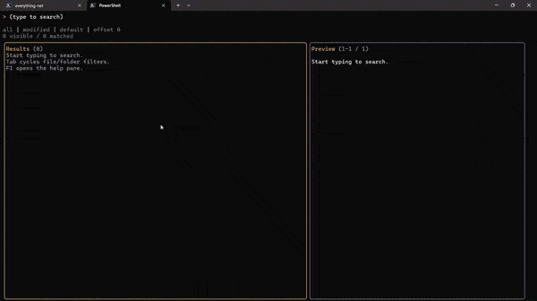

# Everything.Net

[](https://www.nuget.org/packages/Voidtools.Everything.Net/)

Typed .NET wrapper for the voidtools Everything SDK.



NuGet package: `Voidtools.Everything.Net`

Supported target frameworks:

- `net10.0`
- `net11.0`

## Supported architectures

- Windows x64
- Windows ARM64

## Requirements

- Windows
- Everything 1.4 or 1.5 installed and running
- The native SDK DLL, which the package brings with it (see [Native DLL](#native-dll))

## Registration

```csharp
using Everything.Net.DependencyInjection;
using Microsoft.Extensions.DependencyInjection;

var services = new ServiceCollection();

services.AddEverythingClient(options =>
{
    options.DefaultMaxResults = 200;
    options.ThrowOnUnavailableClient = true;
});
```

## Usage

```csharp
using Everything.Net.Abstractions;
using Everything.Net.Enums;
using Everything.Net.Models;
using Microsoft.Extensions.DependencyInjection;

var provider = services.BuildServiceProvider();
var client = provider.GetRequiredService<IEverythingClient>();

var response = await client.SearchAsync(new EverythingQuery
{
    SearchText = "invoice dm:today",
    WaitForResults = true,
    Sort = EverythingSort.DateModifiedDescending,
    RequestFlags =
        EverythingRequestFlags.FileName |
        EverythingRequestFlags.Path |
        EverythingRequestFlags.Size |
        EverythingRequestFlags.DateModified
});

foreach (var item in response.Results)
{
    Console.WriteLine($"{item.FullPath} ({item.Size})");
}
```

If `MaxResults` is left at `0`, the client uses `EverythingClientOptions.DefaultMaxResults`.

## Paging

Use `Offset` and `MaxResults` to fetch a window of results instead of materializing a large result set at once:

```csharp
var pageSize = 100;
var page = 2;

var response = await client.SearchAsync(new EverythingQuery
{
    SearchText = "report",
    Offset = (uint)(page * pageSize),
    MaxResults = (uint)pageSize,
    Sort = EverythingSort.NameAscending,
    RequestFlags =
        EverythingRequestFlags.FileName |
        EverythingRequestFlags.Path
});

Console.WriteLine($"Total matches: {response.TotalResults}");
Console.WriteLine($"Returned this page: {response.Results.Count}");

foreach (var item in response.Results)
{
    Console.WriteLine(item.FullPath);
}
```

## Query Features

`SearchText` is passed directly to Everything, so Everything search syntax, filters, and macros can be used as-is.

The query model also exposes common matching options such as regex, case sensitivity, whole-word matching, and path matching:

```csharp
var response = await client.SearchAsync(new EverythingQuery
{
    SearchText = @"^report-\d{4}\.pdf$",
    Regex = true,
    MatchCase = false,
    MatchWholeWord = false,
    MatchPath = false
});
```

## Everything versions and SDKs

Everything has two SDKs, and the client supports both:

| SDK | Made for | DLL | How it talks to Everything |
|---|---|---|---|
| 2 | Everything 1.4 (also works with 1.5) | `Everything64.dll`, `EverythingARM64.dll` | Window messages |
| 3 | Everything 1.5 only | `Everything3_x64.dll`, `Everything3_ARM64.dll` | Named pipes |

By default the client decides on every call: if Everything 1.5 answers on its pipe it uses SDK 3, otherwise SDK 2.
The same queries, options and result types work with both.

```csharp
services.AddEverythingClient(options =>
{
    options.SdkVersion = EverythingSdkVersion.V2;   // or V3; the default is Auto
    options.InstanceName = "1.5a";                  // SDK 3 only; by default the unnamed instance, then "1.5a"
});

var client = (EverythingClient)provider.GetRequiredService<IEverythingClient>();
client.Search(EverythingQuery.Default("*.txt"));
Console.WriteLine(client.SdkVersion);        // V2 or V3: what the last call used
Console.WriteLine(client.NativeLibraryPath); // the DLL it loaded
```

## Native DLL

Each SDK DLL is looked for in this order, and the first one found is loaded:

1. `EverythingClientOptions.NativeLibraryPath`, if you set it (the folder that contains the DLLs, or one of the DLLs).
2. The folder Everything is installed in: `<install>\sdk\dll`, then `<install>`. The install folder is read from the machine-wide registry.
3. The copy bundled with this package, under `runtimes/win-x64/native` and `runtimes/win-arm64/native`.

The Everything installer does not include the SDK DLLs, so most machines use the bundled copies. Step 2 only applies
if you have put an SDK into the install folder yourself. Set `PreferInstalledNativeLibrary = false` to skip it.

Each DLL is loaded once per process, so the options of the first client that is created decide where from.
